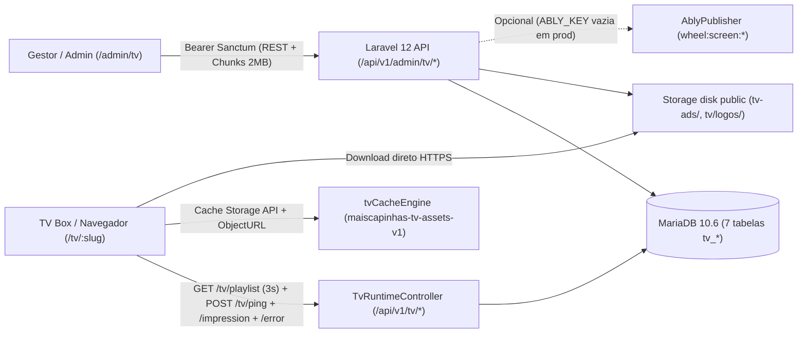

# Arquitetura — TV Digital Signage (ERP Mais Capinhas)

## 1. Visão Geral

O módulo de **TV Digital Signage** opera integrado ao monólito Laravel 12 (`api.maiscapinhas.com.br`) e à SPA React 18 / TypeScript / Vite (`erp.maiscapinhas.com.br`), sem microserviços adicionais.

## 2. Componentes Recuperados

### Backend (Laravel 12 / PHP 8.2)
- **Controllers:**
  - `app/Http/Controllers/Api/V1/Admin/TvAdController.php` — gestão completa de anúncios, upload em chunks, telas, controle remoto, estatísticas, analytics, estúdio de design e logs.
  - `app/Http/Controllers/Api/V1/Tv/TvRuntimeController.php` — runtime público do player (playlist + template resolvido, heartbeat + sessões de uptime, impressões e logs de erro).
- **Models:**
  - `TvAd`, `TvAdStoreTarget`, `TvScreen`, `TvAdImpression`, `TvLog`, `TvScreenSession`.
- **Migrations (5 arquivos históricos preservados):**
  - `2026_03_03_100000` até `2026_03_03_140000`.
- **Rotas:** `routes/api_v1.php` (4 rotas públicas em `/api/v1/tv` + 15 rotas autenticadas em `/api/v1/admin/tv`).
- **Integrações Compartilhadas:**
  - `App\Services\Wheel\AblyPublisher` — injetado opcionalmente em `TvAdController::__construct()`. Em produção `ABLY_KEY` não está configurada, portanto chamadas viram no-op com log de aviso e o player sincroniza via polling HTTP.
  - `app/Models/Store.php` — relacionamento de segmentação (`tv_ad_store_targets`) e 1:1 operacional com `tv_screens`.
  - `app/Models/User.php`, `app/Http/Controllers/Api/V1/MeController.php`, `app/Providers/AppServiceProvider.php` — suporte consolidado a `super_admin` (coluna booleana ou role Spatie), permissão `screen.tv.ads` em `/api/v1/me` e acesso a todas as lojas ativas.
  - Disco `public` (`storage/app/public` exposto em `public/storage`): pastas `tv-ads/` e `tv/logos/`, além de `storage/app/temp/chunks/` para montagem temporária de vídeos grandes.

### Frontend (React 18 / TypeScript / Vite / TanStack Query)
- **Admin:** `TvAdsManager.tsx` (5 abas: Grade, TVs, Estúdio de Design, Estatísticas & Uptime, Logs & Auditoria), `TvDesignStudio.tsx` e `TvStoreAnalytics.tsx`.
- **Player Público:** `TvPlayer.tsx` (`/tv/:slug` e `/tv`), `TvOverlayWidgets.tsx` (Relógio, Badge da Loja, Ticker/Letreiro, QR Code e Logomarca).
- **Camada de Dados & Upload:** `tv.service.ts`, `use-tv-ads.ts`, `chunkedUpload.ts` (fatias de 2 MB com 3 tentativas), `tvCacheEngine.ts` (Cache Storage API), `tv.types.ts`.
- **Configuração de Segurança Web:** `index.html` (CSP incluindo `media-src`, `frame-src` e `connect-src` para mídias e Ably).

## 3. Ciclo de Vida de uma Propaganda

1. **Cadastro no ERP (`/admin/tv`):** gestor envia foto ou vídeo; arquivos de vídeo ou maiores que **1,5 MB** são fatiados em blocos de **2 MB** (`POST /admin/tv/ads/upload-chunk`) e unificados em `storage/app/public/tv-ads/`.
2. **Persistência e Targeting:** `POST /admin/tv/ads` salva registro em `tv_ads` e, quando `is_global = false`, sincroniza lojas em `tv_ad_store_targets`.
3. **Notificação:** `TvAdController::notifyScreens()` tenta publicar evento `ads_updated` via `AblyPublisher` (canal `wheel:screen:global`).
4. **Geração da Playlist:** TV consulta `GET /api/v1/tv/playlist/{slugOrToken}`; o backend resolve loja/tela, combina `tv_global_settings` + `tv_screens.design_template` e filtra `tv_ads` por `status = active`, janela `starts_at`/`ends_at`, `is_global` ou `targetStores`, e `days_of_week`.
5. **Pre-cache e Reprodução:** `TvPlayer` dispara `preloadPlaylistAssets()` no Cache Storage (`maiscapinhas-tv-assets-v1`) e serve via `URL.createObjectURL()`.
6. **Telemetria:** a cada conclusão de slide dispara `POST /tv/impression/{slug}`; em erro de vídeo dispara `POST /tv/error/{slug}`; envia heartbeats em `POST /tv/ping/{slug}` mantendo sessões em `tv_screen_sessions`.
