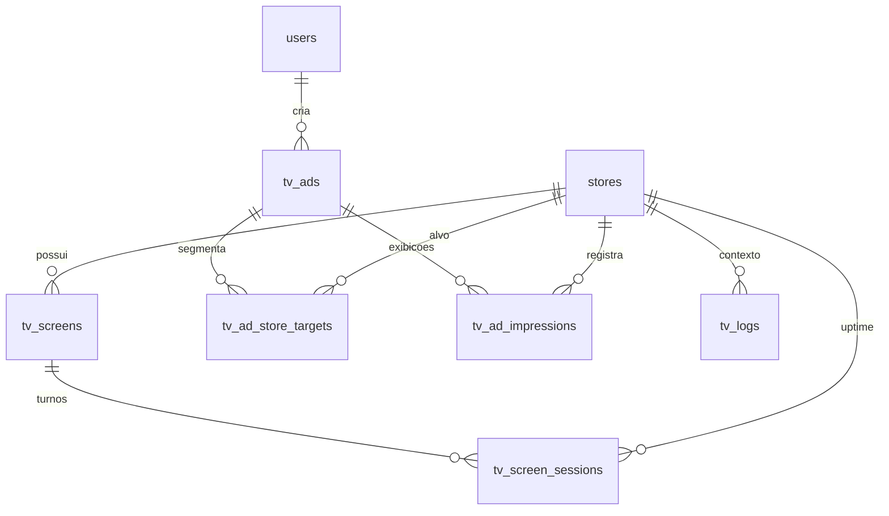

# Banco de Dados e Migrations — TV Digital Signage

## 1. Ambiente de Produção Auditado (Somente Leitura)

- **SGBD confirmado:** `10.6.28-MariaDB-cll-lve` (InnoDB, `utf8mb4_unicode_ci`)
- **Drift de schema:** **ZERO divergências.** Todas as 7 tabelas `tv_*`, colunas, tipos, defaults, chaves estrangeiras e índices em produção correspondem integralmente às 5 migrations recuperadas.
- **Histórico na tabela `migrations` (batches 43–47, executadas em `14/08/2026`):**

| ID | Batch | Migration (nomes históricos preservados) | Criada em Prod (UTC) |
| --- | --- | --- | --- |
| 131 | 43 | `2026_03_03_100000_create_tv_screens_and_ads_tables` | `2026-08-14 03:56:21` |
| 132 | 44 | `2026_03_03_110000_create_tv_telemetry_and_logs_tables` | `2026-08-14 04:13:13` |
| 133 | 45 | `2026_03_03_120000_add_is_blackout_to_tv_screens` | `2026-08-14 04:37:11` |
| 134 | 46 | `2026_03_03_130000_create_tv_screen_sessions_table` | `2026-08-14 04:58:55` |
| 135 | 47 | `2026_03_03_140000_add_design_template_to_tv_screens_and_globals` | `2026-08-14 05:23:15` |

> **Nota histórica:** os timestamps `2026_03_03_*` foram escolhidos para seguir sequencialmente a última migration então existente (`2026_03_02_134900_create_cash_closing_attachments_table`). **Nunca renomear esses arquivos**, pois já constam na tabela `migrations` de produção.

## 2. Modelo Entidade-Relacionamento

## 3. Volumetria Observada em Produção (`19/11/2026`)

| Tabela | Linhas (estimativa InnoDB) | Dados | Índices | Total | Observação |
| --- | ---: | ---: | ---: | ---: | --- |
| `tv_ads` | 29 | 16 KB | 64 KB | 80 KB | Usa `SoftDeletes` |
| `tv_ad_store_targets` | 2 | 16 KB | 32 KB | 48 KB | Pivô N:N (`UNIQUE(tv_ad_id, store_id)`) |
| `tv_screens` | 15 | 32 KB | 64 KB | 96 KB | 1 tela por loja cadastrada |
| `tv_global_settings` | 0 | 16 KB | 16 KB | 32 KB | Fallback no template default em código |
| `tv_screen_sessions` | 787 | 368 KB | 192 KB | 560 KB | Histórico de uptime por turno |
| `tv_logs` | 3.219 | 2,5 MB | 528 KB | 3,0 MB | Sem política de expurgo |
| `tv_ad_impressions` | **320.207** | **31,6 MB** | **35,7 MB** | **67,3 MB** | **Crescimento acelerado (~100k linhas/mês)** |

## 4. Detalhamento de Tabelas, Foreign Keys e Índices

- **`tv_screens`:** `id`, `store_id` (FK `stores.id` `NULL ON DELETE`), `name`, `slug` (UNIQUE), `screen_key` (UNIQUE), `access_token` (nullable — **sem índice!** ver P2), `orientation`, `is_online` (IDX), `is_blackout`, `current_ad_title`, `current_ad_id`, `fps`, `uptime_seconds`, `last_ping_at`, `device_info` (JSON), `design_template` (JSON), timestamps. Índices: `(store_id, slug)`, `is_online`.
- **`tv_ads`:** `id`, `title`, `media_type`, `media_url`, `media_path`, `thumbnail_url`, `duration_seconds`, `target_orientation`, `is_global`, `status`, `starts_at`, `ends_at`, `days_of_week` (JSON), `order_priority`, `created_by_user_id` (FK `users.id` `NULL ON DELETE`), timestamps, `deleted_at`. Índices: `idx_tv_ads_schedule(status, starts_at, ends_at)`, `(is_global, status)`, `order_priority`.
- **`tv_ad_store_targets`:** `id`, `tv_ad_id` (FK `tv_ads.id` `CASCADE`), `store_id` (FK `stores.id` `CASCADE`), timestamps. Índice: `UNIQUE(tv_ad_id, store_id)`.
- **`tv_ad_impressions`:** `id`, `tv_ad_id` (FK `tv_ads.id` `CASCADE`), `store_id` (FK `stores.id` `NULL ON DELETE`), `screen_slug` (IDX), `duration_played_seconds`, `completed_naturally`, `media_type`, `displayed_at`, timestamps. Índices: `(tv_ad_id, displayed_at)`, `(store_id, displayed_at)`, `screen_slug`. **Falta índice isolado em `(displayed_at)`** para consultas globais sem `store_id`.
- **`tv_logs`:** `id`, `level`, `event`, `screen_slug`, `store_id` (FK `stores.id` `NULL ON DELETE`), `message` (VARCHAR 255), `context` (JSON), timestamps. Índices: `(level, created_at)`, `(screen_slug, event)`.
- **`tv_screen_sessions`:** `id`, `store_id` (FK `stores.id` `CASCADE`), `screen_id` (FK `tv_screens.id` `CASCADE`), `screen_slug` (IDX), `started_at`, `last_ping_at`, `ended_at` (IDX), `duration_minutes`, `ended_reason`, `device_info` (JSON), timestamps. Índices: `(store_id, started_at)`, `(screen_id, started_at)`, `ended_at`.
- **`tv_global_settings`:** `id`, `key` (UNIQUE), `value` (JSON), timestamps.

## 5. Observação sobre Compatibilidade SQLite em Testes Locais

`TvAdController::analytics()` utiliza funções nativas de MariaDB/MySQL (`DAYOFWEEK(displayed_at)` e `HOUR(displayed_at)`). Na suíte automatizada local em SQLite (`TvSignageTest`), essas funções são registradas via `PDO::sqliteCreateFunction` sem modificar o código de produção.
